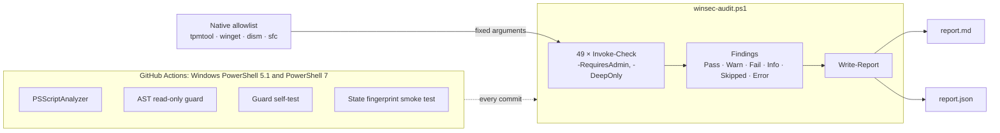

# winsec-audit

[](https://github.com/Blackwellcode/winsec-audit/actions/workflows/ci.yml)

Lightweight, **read-only** security audit for Windows 10/11 workstations. A single PowerShell script with no dependencies. It runs 49 checks and writes a Markdown and a JSON report.

It never changes your system: no registry writes, no service or firewall changes, no scans, no repairs, no installs. That is enforced on every commit by a static AST guard plus a runtime test that fingerprints system state before and after the run.

## Quick start

```powershell
git clone https://github.com/Blackwellcode/winsec-audit.git
cd winsec-audit
powershell -ExecutionPolicy Bypass -File .\winsec-audit.ps1
```

Run it from an **elevated** PowerShell for the full audit. Without elevation, admin-only checks are reported as `Skipped`, and some others fall back to weaker evidence (Secure Boot from the registry, BitLocker from a shell property).

| Option | Effect |
| :--- | :--- |
| `-Deep` | adds `DISM /ScanHealth` and `sfc /verifyonly` (elevated, a few minutes; both only verify) |
| `-SkipWinget` | no `winget upgrade` listing, so no network access at all |
| `-Redact` | replaces user name, computer name and profile path in the report (for sharing) |
| `-FailOn High` | exit code 3 if a check of that severity or higher failed (for scheduled runs/CI) |
| `-OutputPath <dir>` | report location (default `.\reports\<host>-<timestamp>\`) |
| `-Quiet` | no console output |

Downloaded the ZIP instead of cloning? Windows marks it as coming from the internet; run it with `-ExecutionPolicy Bypass` as shown above, or `Unblock-File .\winsec-audit.ps1` once.

## What it checks

| Area | Checks |
| :--- | :--- |
| Patching | last successful update install, pending reboot |
| Microsoft Defender | real-time/tamper protection, signature age, scan age, cloud/PUA/network protection, ASR rules, exclusions, active threats, Smart App Control, email and removable drive scanning, extended cloud check |
| Firewall | profiles and default inbound action, script interpreters reachable inbound on Public networks, network categories |
| Network | SMBv1 (server; client feature when elevated), SMB signing and guest logons, RDP/NLA, WinRM/RemoteRegistry/sshd/Telnet/Remote Assistance, LLMNR/NetBIOS, listening ports, hosts file, Point and Print driver installation (PrintNightmare), legacy Telnet/TFTP clients |
| Accounts | UAC, built-in Administrator/Guest, local administrators, auto-logon password, enabled local accounts |
| Platform | Secure Boot, TPM 2.0, BitLocker, HVCI/Credential Guard, LSA protection/WDigest, vulnerable driver blocklist |
| Logging | script block logging and 4688 command lines, execution policy, PowerShell 2.0, event log sizes, process creation auditing (event 4688 recorded) |
| Persistence | unsigned autostarts, orphaned/unsigned scheduled tasks, unsigned services and unquoted service paths, Winlogon/AppInit/IFEO hijacks, WMI subscriptions, local root CAs with private keys |
| Software | outdated packages via `winget upgrade` |
| Integrity | unsigned kernel drivers in `System32\drivers`; with `-Deep`: DISM and SFC |

Each check reports `Pass`, `Warn`, `Fail`, `Info`, `Skipped` or `Error`, with evidence and a suggested fix. The **score** is the weighted share of passed checks (Warn counts half; Info/Skipped/Error are not scored). It is a heuristic, not a certification.

## How it works



Each check runs on its own: an exception becomes an `Error` finding for that check, and the run continues.

## Why you can trust "read-only"

1. **Static guard** (`tests/Test-ReadOnly.ps1`) parses the script's AST and fails if it finds:
   - a command outside a read-only allowlist (`Get-`, `Test-`, `Select-` …);
   - file writes outside the report writer;
   - `&` invocations outside the native-command wrapper;
   - direct `*.exe` calls;
   - .NET/COM methods that write, delete, start or kill;
   - non-allowlisted COM objects;
   - repair/install arguments such as `/scannow` or `/RestoreHealth`.
2. **Native allowlist**: the only external programs are `tpmtool getdeviceinformation`, `winget upgrade --include-unknown --disable-interactivity` (lists, never installs), `dism /Online /Cleanup-Image /ScanHealth` and `sfc /verifyonly`. All four are hard-coded in one table with fixed arguments.
3. **Guard self-test** (`tests/Test-GuardSelf.ps1`) feeds 30 forbidden samples (`Set-ItemProperty`, `Remove-Item`, `Set-MpPreference`, `Invoke-CimMethod`, `sfc /scannow`, …) to the guard and requires each to be rejected, plus 2 clean samples that must pass.
4. **Runtime proof** (`tests/Test-Smoke.ps1`) snapshots firewall rules, services, scheduled tasks, Defender preferences and key registry values, runs the audit, and compares. Windows changes some of this on its own: BITS toggles its start type, and maintenance jobs update tasks. So every changed object is attributed through the event log (System 7040, TaskScheduler 140–142). A change that an event assigns to another actor, such as SYSTEM or the machine account, is reported as background activity. Any change without such attribution fails the test.

Side effects that remain: Windows itself writes to its own logs (`CBS.log`, `dism.log`) during `-Deep`, and `winget` refreshes its package cache.

## Privacy

Reports contain host name, user name, account names, installed software and listening ports. They are written only to disk. The script makes no network connection except the `winget` source query, and `-SkipWinget` turns that off. `reports/` is git-ignored; use `-Redact` before sharing a report.

## Development

```powershell
.\tests\Test-ReadOnly.ps1     # static read-only guard
.\tests\Test-GuardSelf.ps1    # guard negative tests
.\tests\Test-Smoke.ps1        # run + state fingerprint + report schema
```

CI (`.github/workflows/ci.yml`) runs PSScriptAnalyzer and all four tests on `windows-latest` under Windows PowerShell 5.1 and PowerShell 7.

Adding a check: call `Invoke-Check` with an `Id`, `Category`, `Title`, `Severity`, `Weight` and a body that returns `New-Finding Pass|Warn|Fail|Info "<evidence>" "<fix>"`. Use `-RequiresAdmin`/`-DeepOnly` where needed. The guard tells you if the body is not read-only.

## License

MIT
